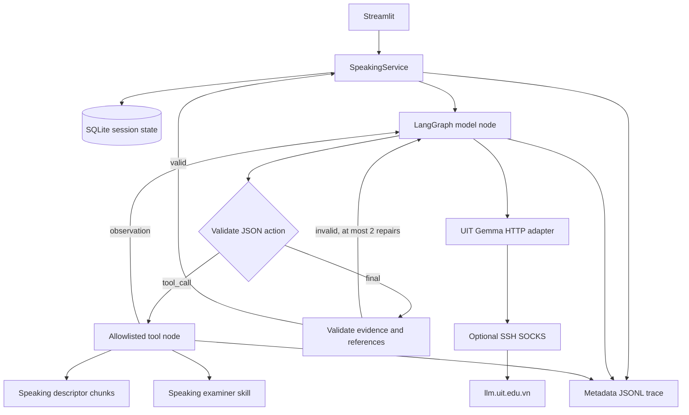

# Kiến trúc Phase 1

Ứng dụng không coi model là nguồn tin cậy về state hay số học. Service kiểm
soát thứ tự Part 1/2/3, đủ 60 giây chuẩn bị, 9 câu trả lời và kết thúc. Model
chịu trách nhiệm chọn tool khi tạo câu hỏi/chấm bài, nội dung câu hỏi Part 3 và
nhận xét theo tiêu chí. Tool tính tổng bằng Decimal, làm tròn đến 0,5 gần nhất.

State `Session`: part, asked_questions, candidate_points (exact spans có turn_id),
elapsed_seconds, answers, preparation_started_at, pending_action, assessment,
flags, run_ids. Lưu state trước mọi network call. Retry chỉ thực hiện bước còn
thiếu, không ghi thêm câu trả lời. Đây là phục hồi phiên Speaking local, không
phải triển khai UC09 full mock test.

Bản v2 bắt buộc có bank_item snapshot và bank_version/hash; chỉ dùng bộ đề mới.
Mỗi lượt Part 3 lấy một discussion focus
và câu tham khảo của bank; response_support chọn cách gợi mở theo số từ (<=5,
6–34, >=35), không gán band sau từng lượt. Candidate points là các đoạn câu nguyên
văn có giới hạn, không phải bản tóm tắt ngữ nghĩa đã được xác minh.
Nhánh short_answer buộc câu hỏi không quá 28 từ gồm cả anchor.

Agent loop có tên node, giới hạn model calls và repair. Tool name và arguments
được kiểm tra bằng Pydantic. Model chỉ được đọc skill/descriptor và tính band,
không được tự ghi DB, chọn đường dẫn hay gọi shell. Service ghi DB sau validation.

Final assessment được kiểm tra ba tiêu chí không trùng, evidence có trong đúng
turn của người học, refs đã truy xuất và thuộc đúng tiêu chí Speaking, đã tính
band bằng tool. Code tạo vị trí ký tự trong transcript, band tổng, disclaimer và
Pronunciation `not_assessed`. Không lưu chain-of-thought của model.
Toàn bộ kết quả cuối được kiểm tra bằng SpeakingAssessment trước khi lưu/xuất.

## Giới hạn cần biết

- Đây là app local không có tài khoản; mã phiên là khả năng truy cập dữ liệu demo.
  Không dùng cho người thật/multi-user trước khi bổ sung authentication và scope.
- Kiểm tra quote chứng minh nguồn trích, không tự chứng minh nhận xét/band đúng.
- Kiểm tra lặp dùng chuẩn hoá, SequenceMatcher, độ trùng token, rồi một model
  invocation riêng so sánh mục đích câu hỏi. Model reviewer có thể sai; không
  được suy ra đảm bảo 0 trùng nghĩa trên mọi đầu vào. Lượt reviewer cũng tính
  trong giới hạn 10 model calls/tác vụ.
- Regex injection là lớp phát hiện sơ bộ; system prompt và hạn chế tool là lớp
  bổ sung. Text pronunciation được khóa bởi code dù model bị tác động.
- Phiên có thể retry hữu hạn từng tác vụ; không tự retry vô hạn khi API lỗi.
- Không có band reference được con người xác nhận; chưa thể đánh giá grading accuracy.
